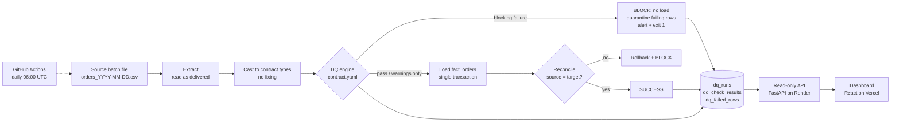

# Architecture

**Design decisions**
- *Gate before load.* Checks run on the in-memory batch; the target is untouched unless everything blocking passes.
- *Contract as configuration.* "Good data" lives in `contracts/orders.yaml`; reusing the pipeline for another dataset means a new contract and a new source/target mapping.
- *Observe, never repair.* Unparseable values become null for checking only; nothing is corrected or guessed.
- *Skipped is not passed.* A check that cannot run (no history, schema broken) is recorded as SKIPPED and shown as such.
- *Staging is in memory.* Raw rows for failing checks are persisted to `dq_failed_rows` (capped per check), which keeps the metadata DB small.

**Deployment shape.** GitHub Actions generates the day's simulated batch and runs the pipeline against Neon
Postgres. Render serves the read-only API from the same database; Vercel serves the static dashboard.
`etl/db.py` hides the SQLite/Postgres differences (placeholders, transactions, driver) behind one small class.
