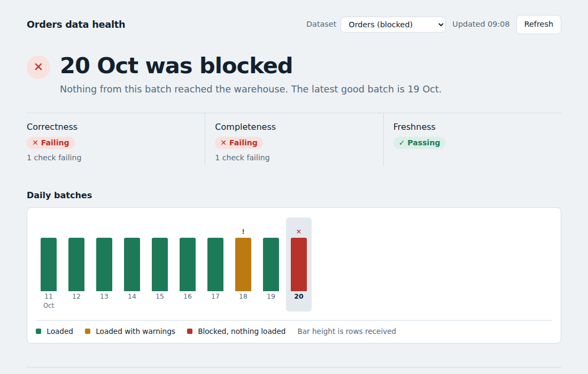
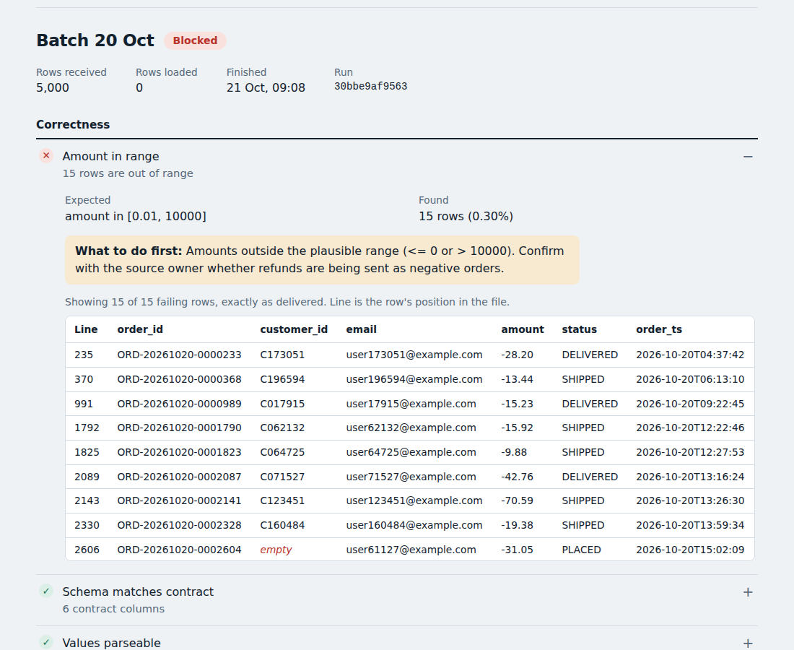

# Proposal: a data-quality gate for the orders warehouse load

## The problem
When a source system sends a bad batch (duplicates, missing fields, a half-finished extract, stale data), the
warehouse usually loads it anyway. The error surfaces days later in a report, and finding the cause means reading
pipeline code. Nobody can answer a simple question on demand: *is today's data healthy, and if not, why?*

## What this project does
It puts a quality gate in front of the load. Each daily batch is checked against a **data contract** (a YAML file
that *is* the definition of good data) across three pillars: **correctness, completeness, freshness**.

- **Pass:** the batch is loaded in one transaction and reconciled against the source.
- **Fail:** nothing is loaded, the failing rows are stored for diagnosis, an alert is sent, the run exits non-zero.
- **Never silent:** bad values are not repaired or guessed; a check that cannot run is shown as *skipped*, not passed.

Anyone can read the result on a dashboard, without reading code:

A failed batch shows what failed, expected versus found, a suggested first step, and the offending rows exactly as
delivered:

## Evidence that it works
Each defect below is injected on demand by the simulator, and each is covered by an automated test that proves it is
caught and that nothing bad reaches the warehouse. The same tests run on SQLite and PostgreSQL in CI.

| Defect | Caught by | Outcome |
|---|---|---|
| Same order twice in one batch | `order_id_unique` | Blocked |
| Old orders re-sent in a later batch | `order_id_not_loaded_before` | Blocked |
| Empty required field (e.g. customer) | `required_fields_not_null` | Blocked |
| Negative or absurd amount | `amount_in_range` | Blocked |
| Unknown status value | `status_accepted` | Blocked |
| Text where a number belongs | `values_parseable` | Blocked |
| Stale data / re-delivered old file | `freshness_within_sla` | Blocked |
| Partial extract or outage | `row_count_in_band` (weekday-aware) | Blocked |
| Source changed its file layout | `schema_matches_contract` | Blocked (dependent checks shown as skipped) |
| File never arrived | `source_available` | Blocked |
| Malformed email | `email_format` | Loaded, flagged as a warning |
| Load does not match the source | `source_equals_loaded` | Rolled back |

Beyond simulated data, the pipeline replays the public **Olist** e-commerce dataset (about 99k real orders) as daily
batches, including its real weekday pattern and real defects such as orders with no payment record
(see [real-data.md](real-data.md)). Reruns are idempotent, and the dashboard keeps every attempt on record.

## What adopting it would involve
1. **Point it at one real dataset.** Write a contract for it and map its columns (the dataset-specific work);
   everything else is reused. Replace the simulated delivery step with the real feed.
2. **Schedule it.** A daily GitHub Actions workflow is included; any scheduler works.
3. **Host the dashboard.** The repository is configured for Vercel (UI and API) with a PostgreSQL database; the
   pilot fits on free tiers (check each provider's current limits). The API can run on a read-only database role.

## Honest limits
- Proven on simulated and replayed public data, not yet on a production feed.
- No user authentication on the dashboard yet; datasets share one target table shape.
- The volume baseline needs a few comparable batches before it activates and must be told about expected spikes
  (Black Friday, promotions) via `known_events`.
- The full list is in [assumptions-limitations.md](assumptions-limitations.md).

## Roadmap
Per-dataset target tables, dashboard authentication, alert routing, a rerun button, bulk loading for large batches
([next-steps.md](next-steps.md)).

## Decision requested
Approve a **pilot on one real dataset**. Suggested success criteria, to be agreed up front: every blocking failure is
visible the same day, no failing batch reaches the warehouse table, and the false-alarm rate is acceptable to the
data owners.
